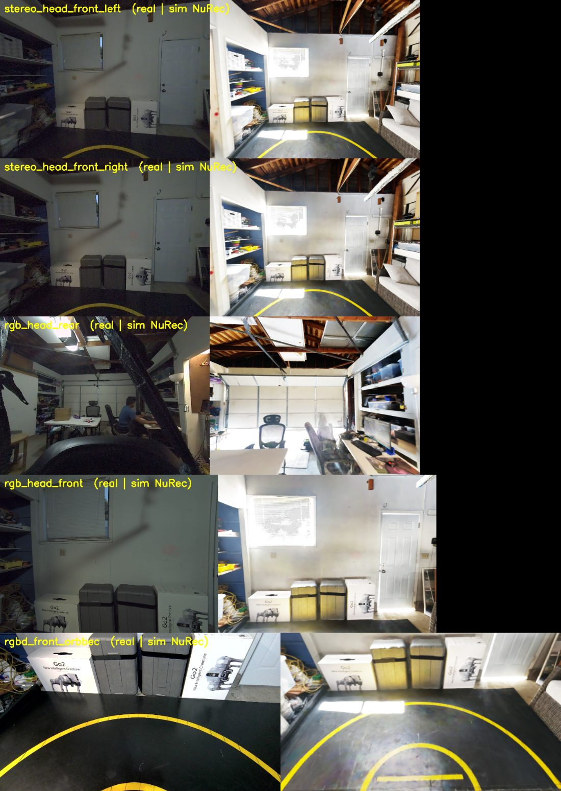

# x2-groot-vla

Bootstrap an X2-native GR00T VLA base model **without teleop**: convert
boneseed mocap manipulation clips (pure motion, dummy hand, no object) into
synthetic LeRobot episodes by placing objects exactly where the executed hand
reaches — in the x2-kitchen-sim gaussian-splat kitchen (IsaacLab) — then
fine-tune GR00T on the result. People extend the base checkpoint with real
recorded datasets from there.

**The full plan (canonical): [docs/PLAN.md](docs/PLAN.md).**

## Relationship to sibling repos

| repo | role |
|---|---|
| `~/Projects/GR00T-WholeBodyControl` | runtime: SONIC policy, eval stacks, manager env, recorder/exporter, VLA train/eval scripts |
| `~/projects/x2-kitchen-sim` | world: Scaniverse splat kitchen (NuRec USD), collision mesh, nav grid, waypoints |
| this repo | pipeline: reach extraction, spawn/surface matching, scene baking, batch episode generation, dataset QA |

Like x2-kitchen-sim, this repo holds pipeline scripts, configs, and analysis
artifacts — heavyweight runtime code stays in GR00T-WholeBodyControl.

`assets/` holds worlds ingested here: **garage** (splat + collision + camera
calibration data — the camera-calibration venue, see
[docs/CAMERAS.md](docs/CAMERAS.md)) and the kitchen `.spz` source. Splat
binaries (`*.usdz`, `*.ply`, `*.spz`) are gitignored — regenerate with
`x2-kitchen-sim/scripts/01a_spz_to_usdz.py` (splat) and
`01c_mesh_align_to_usd.py` (collision), both run with
`~/projects/g1-kitchen-sim/.venv/bin/python`.

## Core mechanism (one paragraph)

Pass A executes a boneseed clip through the SONIC ONNX with no objects and
FKs the **executed** palm trajectory; the grasp moment is the low-speed dwell
at the reach extremum. Pass B bakes an object (+ stand where no real surface
fits) at that exact pose as static/rigid entries in the scene, re-executes the
same clip, and records the rollout as a LeRobot episode. Determinism makes
the hand land on the object (bit-exact in MuJoCo; PhysX tolerance gate for
IsaacLab pending). Robot spawn (x, y, yaw) is chosen so the body-frame reach
offset lands on a real kitchen surface whose height matches the executed
reach z: counters ~0.88–0.94 m for `*_medium` clips, pantry shelf 1.29 m for
`*_high`, bench/sofa/console or floor stands for `*_low`. v0 task tier is
"reach the object"; grasp (finger-close overlay) is tier G.

## Camera setup (sim ↔ real)

**[docs/CAMERAS.md](docs/CAMERAS.md)** is the canonical reference for the
five head cameras: stream/frame_id/device naming (including the traps that
bite everyone once), PC2 access recipe, real intrinsics, the calibrated
URDF variant, and the four rules for placing cameras in sim so renders
match reality. Verified 2026-08-04 against the garage splat with the real
robot — all five mounts confirmed correct; raw data in
[`assets/garage/calib_2026-08-04/`](assets/garage/calib_2026-08-04/).

*Real (left) vs sim (right) for all five head cameras — X2 standing at the
garage circle centre, sim rendered from the calibrated URDF poses through
each camera's own intrinsics into the NuRec splat of the same room.
Full resolution:
[`all_cams_NUREC_v3.png`](assets/garage/calib_2026-08-04/pose_match/all_cams_NUREC_v3.png).*

## Analysis artifacts (2026-08-03)

- `analysis/pickup_sweep_reach_2026-08-03.csv` — 73-clip stratified sweep
  through the deployed X2 ONNX (MuJoCo, walk_101 tuning): end reason, active
  hand, executed reach z, body-frame reach offset, t*. Result: 70/73 clean;
  only falls = `two_hands_*_right_side_low`.
- `analysis/sweep_reasons.txt` — raw per-clip end reasons.
- `analysis/passA_reach.npz` — M0 reach extraction for
  `locomanip__small_light_one_hand_pick_up_front_low_002__A506`
  (reach z 0.452 m @ t=2.06 s; MuJoCo determinism was bit-exact).
- `analysis/kitchen_surfaces/` — kitchen support surfaces from the collision
  mesh: heights, areas, placement spots with clearance radii, walkable
  standing bands (JSON + rerunnable script + debug render).

## Status

M0-kitchen smoke largely PASSED (2026-08-03): the bridge `--sonic-onnx`
route is dead (known shelved "assembly gap" — crash-loops even on flat
ground); the **manager-env route** (`eval_x2_isaacsim_onnx --run-dir
<demo_v2> --onnx <deploy onnx>` + Hydra world/motion overrides) plays the
dishwasher-placed front_low clip cleanly at the exact spawn, and **PhysX is
bit-exact run-to-run** (0.0 over 180 frames — same as MuJoCo). Exact
commands + gotchas in PLAN.md "Execution routes in IsaacLab" — critically,
every kitchen run needs `world_pos=[-19.99,-75.96,0.0]` (env-origin offset,
per kitchen-sim-training.md); splat sensor-path rendering was already proven
(nav gate G1). Open: pass-B object/stand baking PoC; IsaacLab→LeRobot
offline converter.
