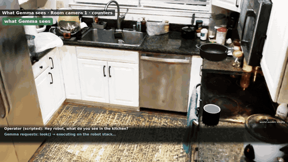
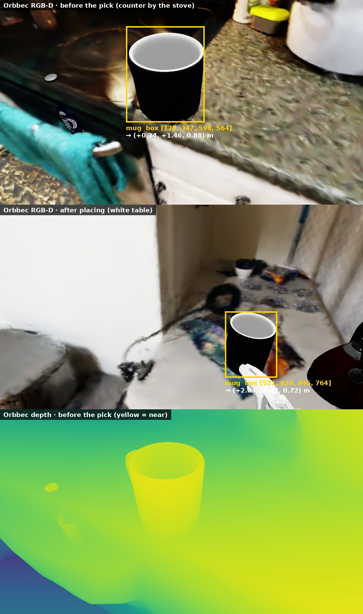
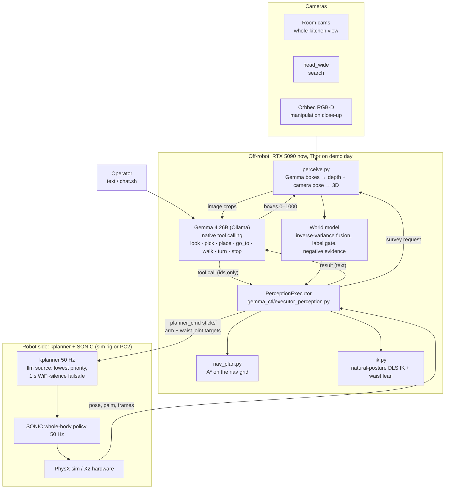
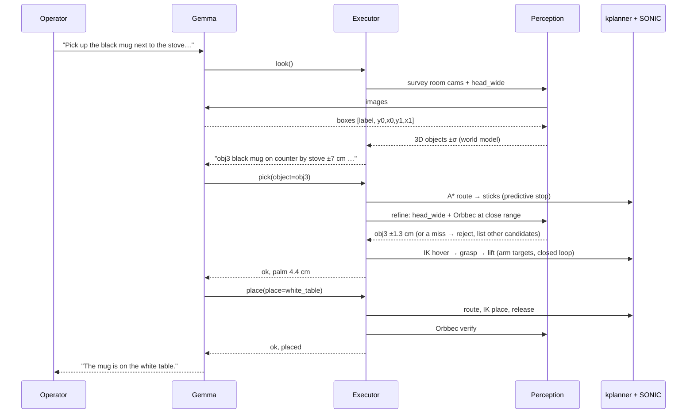
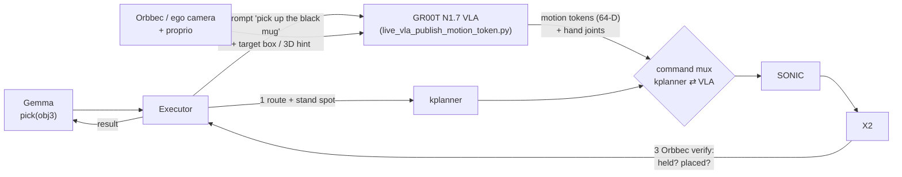

# Gemma → X2: language and perception control

Status (2026-10-23): **proven in sim, not on the robot.** In the IsaacLab
splat kitchen, Gemma 4 26B runs a full pick-and-place starting at the door,
using only its own camera perception. The pick works on the first try: the
position tightens from ±7 cm to ±1.3 cm with the head cameras, the palm is
4.4 cm off at release, and the Orbbec confirms the place.

[](../assets/gemma/gemma_mug_to_table.mp4)

*The take: [`gemma_mug_to_table.mp4`](../assets/gemma/gemma_mug_to_table.mp4)
(1 min 40 s). Bundle: `runs/gemma/bundles/mug_to_table_door_20261023T1442`.*



All of this lives in this repo, on branch `gemma-control`, until the stack
is proven. The few changes the runtime repo (GR00T-WholeBodyControl) needs
are kept here as patches in `patches/` and are not committed there; see
[Running it](#running-it). Working notes, pitfalls and per-run numbers are in
[notes/gemma-control.md](notes/gemma-control.md).

## The idea in one paragraph

Gemma is a **slow task-level planner that calls tools**. It never sees or
emits joint angles or coordinates. It names objects and places by the ids
its own perception produced. Below it, a deterministic executor turns
names into geometry and motion: A* routes, stand spots, and IK palm
targets that are closed-loop on the measured pose. That motion goes out on
the command surfaces that already exist: kplanner sticks plus arm joint
targets. SONIC remains the only thing that moves the body. Gemma runs
**off the robot** (5090 now, Thor on demo day), over WiFi. A lowest-priority
`llm` command source in the kplanner stops the robot if the link goes
quiet.

## Architecture today



Rates: Gemma decides in about 0.2 s per call, a few calls per task step. A
survey takes a few seconds, because Gemma boxes each camera image. The
executor's control loops run at the rig rate. kplanner and SONIC run at
50 Hz.

## One pick, step by step



## Where the GR00T VLA goes

The VLA replaces the **arm part of `pick`/`place`** (IK reach plus the sim
attach). It does not replace Gemma and it does not replace navigation. Each
layer keeps the job it is good at:

| Layer | Owns | Rate |
|---|---|---|
| Gemma | what to do, which object, where to put it, when to retry or ask | ~0.2 s per decision |
| Executor + world model | where things are, route, stand spot, hand-off and checks | event-driven |
| **GR00T VLA** | **the manipulation itself, from the Orbbec/ego view and proprioception** | ~150–300 ms per 40-step chunk, played back at 50 Hz |
| kplanner | locomotion reference | 50 Hz |
| SONIC | balance and tracking | 50 Hz |



The hand-off contract, as proposed (not built yet):
1. **Before the hand-off:** the executor walks the robot to the stand spot
   with the existing route code, and checks that the target is in the
   Orbbec view at the refined position. This is the same gate `_refine`
   uses today.
2. **Hand-off:** the mux switches SONIC's input from the kplanner
   reference to the VLA's motion-token stream. The VLA gets a short prompt
   from Gemma's label ("pick up the black mug"). It may also get the target
   box from the world model, if the VLA is conditioned on it.
3. **Done or timeout:** the executor watches proprioception and the
   Orbbec. Held means the object moves with the hand. Placed means it
   rests on the target surface. When either happens, or the time runs out,
   the mux switches back to the kplanner, and the result goes to Gemma like
   today's `pick` result. Gemma's retry and ask-the-user behaviour does not
   change.
4. **Safety:** the `llm` source's lowest priority and WiFi failsafe apply
   to the VLA stream too. Pad/VR preempts both.

Open items before this works:
- **SONIC input modes.** The kitchen rig drives SONIC from a reference
  motion (kplanner rows). The VLA deploy drives it with motion tokens
  (`deploy_x2.sh sim --vla`). We need to confirm the two can be switched
  mid-episode in one process without a transient, or build the mux at the
  token level.
- **Camera domain.** The VLA was trained on MuJoCo ego renders. The
  kitchen is a splat. The Orbbec view in this sim is the matching camera,
  but it needs a domain check.
- **Data loop.** Every Gemma take is saved as a bundle with a 25 Hz
  trajectory and per-frame camera poses. Those could become VLA training
  episodes for the reach tier, through the planned IsaacLab→LeRobot
  converter in [PLAN.md](PLAN.md). The grasp is a kinematic attach today,
  so these episodes teach reaching, not grasping.

## Running it

All commands run from the repo root. They need: the `ollama` Docker
container serving `gemma4:26b` on :11434, and conda env `env_isaaclab`.
One Isaac instance at a time. They also need a GR00T-WholeBodyControl
checkout with the two patches from `patches/` applied (`git apply`). The
default is the worktree `~/Projects/GR00T-WBC-gemma`; set `GEMMA_WBC` to
use another checkout.

Interactive chat (starts a fresh kitchen rig and a new run bundle):

```bash
./gemma_ctl/chat.sh
```

Scripted take (fixed task file, so every run is comparable), then the video:

```bash
RUN=runs/gemma/bundles/mug_$(date +%Y%m%dT%H%M) KP_SPAWN="<x>,<y>,<yaw_deg>" KP_GEMMA_SCENE=gemma_ctl/kitchen_scene_v1.json ./gemma_ctl/launch_kitchen_gemma.sh
```

```bash
./gemma_ctl/finish_take.sh runs/gemma/bundles/<bundle>
```

`finish_take.sh` writes the manifest, stops the rig, re-renders the head
camera by kinematic replay, draws the overlay and builds the paced cut at
`<bundle>/review/paced.mp4`.

Checks that need no sim:

```bash
python -m gemma_ctl.bench
```

```bash
python -m gemma_ctl.test_llm_source
```

## Code map

| File | Role |
|---|---|
| `gemma_ctl/agent.py` | Gemma chat loop, tool dispatch, transcript (`--perception --live`) |
| `gemma_ctl/executor_perception.py` | tool implementations: look, pick, place, go_to, refine, verify |
| `gemma_ctl/perceive.py` | camera views, Gemma box prompts, depth fusion, lift to 3D |
| `gemma_ctl/world_model.py` | object/place fusion, label gate, negative evidence |
| `gemma_ctl/nav_plan.py` | A* routing and stand spots |
| `gemma_ctl/ik.py` | natural-posture damped least-squares arm IK |
| `gemma_ctl/rig_hooks.py` | in-rig hooks: arm/waist overrides, cameras, attach, recording, replay |
| `gemma_ctl/executor.py`, `executor_kitchen.py`, `tools.py` | earlier ground-truth executors and the G0 tool schema |
| `gemma_ctl/bundle.py`, `overlay_video.py`, `make_paced.py`, `finish_take.sh` | run bundles and video |
| `gemma_ctl/scene3d.py` | 3D viewer export of the world model |
| `gemma_ctl/tasks/*.json` | scripted operator tasks |
| `patches/pc2_kplanner_llm_source.patch` | `llm` command source in `pc2_kplanner_onnx.py` (runtime repo) |
| `patches/kitchen_rig_gemma_hooks.patch` | `KP_GEMMA` hooks, `KP_RING_S`, `KP_PAD_PORT`, `KP_SPAWN`, depth camera (runtime repo) |

## Shortcuts, stated plainly

- **Grasp:** a kinematic attach once the palm is within 12 cm. There is no
  finger contact simulation. This is the part the VLA should take over.
- **Depth:** the splat renders no depth, so it comes from the scan's
  collision mesh. On the robot, the Orbbec provides it.
- **head_wide:** the real lens is a ~170° fisheye. The sim renders its
  centre 120° as a pinhole.
- **Not deployed to PC2.** The `llm` source passes its tests in the sim
  rig only. Robot commands need per-action approval.
