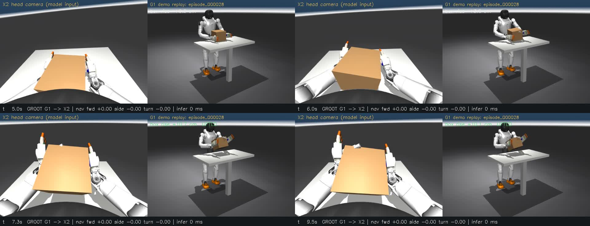

# GR00T (trained on the Unitree G1) driving the AgiBot X2

Status 2026-11-18: a **G1 -> X2 embodiment adapter** runs NVIDIA's frozen
`nvidia/G1-Factory-GR00T-1.7` checkpoint against X2 SONIC (OmniHands on) in the gwbc-x2 MuJoCo
simstack. The adapter is written against a model-agnostic interface so GR00T 2 (announced
2026-11-09, weights expected December 2026) drops in by swapping the target spec.

- **Works:** G1 BoxLift actions executed on the X2 through the adapter — a G1-Factory-Benchmark
  demo replayed open-loop lifts the box cleanly (11 cm, held 3.6 s; 1 of 4 demos clean, all 4 lift
  it off the table). GR00T walking zero-shot: walks to the table and stops in reach.
- **Not yet:** GR00T closed loop picking the box (0 clean lifts in ~18 trials; reaches and partly
  lifts, never commits to the squeeze). Next: fine-tune on filtered X2 replays (section 6).

[](../assets/groot_bridge/x2_boxlift_replay.mp4)

Code: [`groot_bridge/`](../groot_bridge/) — `embodiment.py` (interface), `g1_x2.py` (G1 <-> X2 maps),
`ee_retarget.py` (hand-space arm retarget), `x2_sim_io.py` (X2 simstack I/O + head-camera render),
`run_sim_loop.py` (the loop: GR00T / scripted / demo replay), `tools/` (scene builder, sim restart,
joint-axis check), `specs/g1_to_x2_joint_map.json`.

## 1. What exists

### GR00T checkpoints for the G1 (Hugging Face, checked 2026-11-18)

| Interface (embodiment) | Model output | Public weights |
|---|---|---|
| `unitree_g1_sonic` | 64-d SONIC motion token + 7+7 hand joints, horizon 40 | none (recipe in Isaac-GR00T `examples/GR00TWholeBodyControl`; train your own) |
| `unitree_g1_full_body_with_waist_height_nav_cmd` | arm 7+7, hand 7+7, waist 3, base height 1, navigate (vx, vy, wz) 3 | `nvidia/G1-Factory-GR00T-1.7` (9 G1 Factory sim tasks, 69.4 %), `nvidia/GR00T-N1.6-G1-PnPAppleToPlate` (58 %) |

Chosen: **`nvidia/G1-Factory-GR00T-1.7`** (6.9 GB, GR00T N1.7, Cosmos-Reason2-2B backbone, matches
the Isaac-GR00T code vendored in GR00T-WholeBodyControl). Read from its `experiment_cfg/`:

- **Input**: `ego_view` RGB 640x480 (one head camera); state 31 = left_arm 7, right_arm 7,
  left_hand 7, right_hand 7, waist 3 (upper body only, no legs); one English instruction
  (e.g. "Walk to the console and press the red button").
- **Output**: 40-step chunks at 50 Hz (0.8 s) of 35 numbers: the same 31 joints (absolute) +
  `base_height_command` (0.40–0.77 m) + `navigate_command` (vx, vy ±0.5 m/s, wz ±1.0 rad/s). On the G1 a
  separate balance controller turns the last two into leg motion. **On the X2, SONIC plays that role.**

The SONIC-token route does not transfer zero-shot: the X2 SONIC policy is one network
(obs 1670 -> 31 joint actions) with no motion-token decoder, so G1 tokens mean nothing to it.

### What the X2 already accepts (gwbc-x2 kplanner, no changes needed)

| Channel | Port (sim) | Payload |
|---|---|---|
| `planner_cmd` (JSON) | 5663 | `target_velocity = [yaw rad/s, left m/s, forward m/s, hip m]`, `source:"vr"` takes ownership over the pad |
| `arm_targets` (msgpack) | 5572 | `left_q_rad[7]`, `right_q_rad[7]` overlay the planner's arm joints (slewed, 250 ms gap hold) |
| `hand_finger_cmd` (msgpack) | 5572 | `left_hand_q[10]`, `right_hand_q[10]` (OmniHand) |
| `x2_debug` telemetry | 5659 | `body_q[31]`, hand q, base quat (no position) |
| `robot_pose` (sim only) | 5570 | ground-truth pelvis `[x, y, z, qw, qx, qy, qz]` |

## 2. Bridge options

| Option | Work | Carries over to GR00T 2 |
|---|---|---|
| **(a) Zero-shot through an adapter** (built) | X2 -> G1 obs encoder, G1 -> X2 action decoder; frozen G1 checkpoint | swap the TargetSpec (keys, dims, ranges, horizon); decoder unchanged if the action layout stays joints + nav |
| (b) X2 head fine-tune, same output layout as (a) | X2 episodes (SONIC rollouts in sim) in the G1 layout, LoRA on N1.7 (recommended 40 GB; our 5090 has 32 GB, so projector + action head only) | same dataset and adapter re-tuned on GR00T 2 |
| (c) Train the SONIC-token interface for the X2 | needs a token decoder for X2 SONIC + own data | weakest |
| hybrid (a)+(b) | Any2Any-style: frozen core, learned encoder/decoder heads where analytic maps fall short (camera view, hands) | heads retrain against the new frozen core |

Recommendation: (a) now as the integration skeleton; then add learned heads (hybrid) and, if needed,
(b). Both keep the same adapter interface and the same X2 command channels.

## 3. The adapter

```
X2 sensors --[ObsEncoder: X2 -> G1]--> frozen GR00T (G1 embodiment) --[ActionDecoder: G1 -> X2]--> X2 SONIC
```

Each stage is `analytic`, `learned`, or `hybrid` (analytic + learned residual). The interface
(`groot_bridge/embodiment.py`): `TargetSpec` (read from the checkpoint, no hand-typed numbers),
`RobotState`, `RobotCommand`, `ObsEncoder`, `ActionDecoder`, `EmbodimentAdapter`.

### Arm joint order (G1 vs X2)

| Slot | G1 (`left_arm` / `right_arm`) | X2 (31-joint order: left 15–21, right 22–28) |
|---|---|---|
| 0 | shoulder_pitch | shoulder_pitch |
| 1 | shoulder_roll | shoulder_roll |
| 2 | shoulder_yaw | shoulder_yaw |
| 3 | elbow | elbow — **X2 = G1 − π/2** (G1 zero = bent 90°, X2 zero = straight; FK-checked) |
| 4 | **wrist_roll** | **wrist_yaw** |
| 5 | wrist_pitch | wrist_pitch |
| 6 | **wrist_yaw** | **wrist_roll** |

- Wrists are reversed: permutation `[0,1,2,3,6,5,4]` (self-inverse).
- Waist: G1 yaw, roll, pitch; X2 yaw, pitch, roll (X2 indices 12, 13, 14).
- No sign flips: all 14 arm + 3 waist axes agree (axis dot ≥ 0.98 at the zero pose,
  `tools/compare_joint_axes.py`).
- Ranges differ; outputs are clamped to X2 limits. Notable: X2 wrist pitch ±0.56 rad vs G1 ±1.61;
  X2 shoulder roll is one-sided (left −0.06..2.99, right −2.99..0.06).

### Arms: hand space, not joint space

Copying joint angles (the table above) keeps the arm *shape* but not where the hands go. The X2's
shoulders are wider and higher: the G1 BoxLift grasp pose copied joint-for-joint puts the X2 wrists
**0.448 m apart instead of 0.234 m**, so a two-handed squeeze is impossible. The decoder therefore
retargets in hand space (`ee_retarget.py`, `--arm-mode hand`, default): G1 arm joints -> G1 FK ->
wrist pose in the pelvis frame -> X2 damped-least-squares IK (7 joints per arm, position +
orientation, X2 limits) -> X2 arm joints. The encoder runs the inverse (X2 FK -> G1 IK) so GR00T sees a
G1-consistent state. On the BoxLift grasp: X2 wrists within 1.9 / 9.6 mm of the G1's (left limited by
the X2's one-sided shoulder roll), gap 0.242 m; 40 steps decode in 8 ms; encode round trip within
0.02 rad. `--squeeze-offset` (m) adds an inward wrist offset while the source wrists close on an
object (palm/compliance compensation; 0.04 was best). `--hand-align geom` aligns hand geometry
(finger direction + palm normal, 15° / 29° apart at the reference pose) and targets palm centres;
it did not beat wrist alignment in replay.

### Hands

G1 three-finger hand (7 joints) <-> X2 OmniHand (10) through **one grasp ratio per hand**
(G1 Factory drives the hands like grippers). G1 "closed" extremes come from the checkpoint's action
statistics; X2 open/closed poses from gwbc-x2 `x2_hand_retarget.grasp_command_from_ratio` at run time.

### Base

`navigate_command (vx, vy, wz)` -> X2 `target_velocity [wz, vy, vx, hip]`, capped at 0.5 / 0.3 /
0.8. `base_height_command` scaled by 0.687 / 0.77 (X2 standing hip / G1 max), clamped to 0.60–0.687
(below 0.60 needs the X2 crouch mode; v1 stays standing).

### Camera

The X2 head camera `rgbd_head_front` (alias `ego_view`, 40° below horizontal, 1.17 m) is rendered at
640x480, the size the checkpoint expects. The G1 Factory camera (seen in the G1-Factory-Benchmark
videos) is far wider: legs, both arms and the table all in view. **Camera head (analytic):**
`--ego-fovy 90` matches the framing (60° crops the table and enlarges the arms) and greys the floor;
`--g1-look` also paints the X2 body G1-grey (render only; did not change outcomes in 3 trials).

## 4. Results (sim)

| Test | Result |
|---|---|
| Translator unit test on the checkpoint's statistics | X2 stand pose -> G1 state all 31 values in range; mean G1 action -> X2 with 0 clamped joints; G1->X2->G1 round trip exact (4e-9) |
| Scripted G1 "wave" through the adapter | X2 waves (right arm up, forearm swinging), stays up (pelvis 0.66 m); planner logs VR ENGAGED / arm overlay ACTIVE / released cleanly |
| Scripted G1 "forward 0.35 m/s" | X2 walked 0.37 m/s: 2.95 m forward, 0.11 m sideways in 8 s, no fall |
| **GR00T closed loop, zero-shot** ("Walk to the console and press the red button", 25 s, `runs/groot_bridge/groot_pushbutton_1/`) | GR00T commanded walk 0.42 m/s (+0.14 left, +0.16 rad/s turn), the X2 walked 1.1 m and GR00T itself drove the nav command to ~0 at the console with the button centred in the head camera; arms came forward over the console (elbows −1.6..−2.0 rad X2) and held; **no press** (right shoulder pitch never below −0.34, hands stayed open). 55 inferences, 56 ms mean (365 ms first), 0 clamped joints, no fall |

Reading of the zero-shot run: the language + vision -> navigation part transfers (it walked to the
target and stopped in reach); the manipulation part does not yet (the arms hover). Likely causes,
in order: head-camera viewpoint and intrinsics differ from the G1 Factory camera; the render-only
console differs from the G1 Factory console; no G1 Factory scene cues (lighting, textures). These are
what the camera head (learned/hybrid) and X2 data (option b) address.

Known: with arms held up and zero velocity, the X2 drifts ~0.2 m and ~10° over 10 s (SONIC balance
under the arm overlay).

### Manipulation: BoxLift (G1 success 98 %)

PushButton was a poor first target (the G1 model's own success is 42 %; the G1 presses a button on a
vertical pillar, not a desk). BoxLift ("Walk to the table and pick up the box", 98 % on the G1) was
used instead. From 40 G1-Factory-Benchmark LMBoxLift episodes: the G1 walks 1.55 m in 3.5 s, squeezes
the box with open palms (finger joints stay 0), wrists 0.234 m apart, 0.29 m ahead / 0.16 m above the
pelvis, lifts ~8 cm. Scene (`tools/build_x2_console_scene.py --layout boxlift`): X2 + OmniHand with
finger collisions, white table (top 0.75 m), free box 0.22 x 0.21 x 0.18 m, 0.3 kg, friction 1.5;
the bridge publishes the box pose (`scene_state`) and accepts `scene_reset`. Success = **clean lift**:
lowest box corner > 2 cm above the table, tilt < 25°, held >= 1 s.

| Run (`runs/groot_bridge/`) | Result |
|---|---|
| GR00T closed loop, 20-step chunks, joint-copy arms (`groot_boxlift_1`) | walked 1.49 m, stopped in reach, both hands to the box sides, box +2.7 cm |
| + hand-space arms, 0.21 m box, 16-step chunks (`groot_boxlift_4_exec16`) | box +5.2 cm but tilted onto the right hand (scoop, not a squeeze) |
| GR00T batches: 16-step (3), +crossfade (3), squeeze 2/4/6 cm (6), +G1 look (3) | **0 / 15 clean**; best: squeeze 4 cm, box upright 2.4 cm off the table < 1 s. FK of GR00T's outputs: wrist gap closes to 0.25–0.26 m then reopens to 0.29–0.41 m, wrists rise to +0.21 m (G1: 0.234 m, +0.24 m): it never commits |
| 40-step chunks (`groot_boxlift_3_exec40`) | open-loop walking drifted past the table: re-planning every 0.32 s matters |
| **G1 demo replay** through the adapter, box placed 0.40 m ahead when the demo's walk ends (`batch_replay4`) | **ep 28: clean lift — box +11.1 cm, corner 4–8 cm off the table, tilt 15–23°, held 3.6 s**; ep 19 / 20 / 75 lift it off the table (+4–15 cm) but tilt past 25° |

Reading: the adapter + SONIC + OmniHands can execute the G1's BoxLift on the X2 (replay); the tilt
comes from where the palms meet the box (they pinch above/behind its centre, so it hinges), and run
to run variance is high. GR00T closed loop does not commit to the squeeze on X2 images. The replays
that lift cleanly are an X2 dataset in the G1 action layout: option (b).

## 5. Running it

```bash
# 1. X2 sim, planner mode, headless (sim only; never contacts PC2)
cd ~/Projects/gwbc-x2
X2_WHOLE_BODY_TELEOP=0 SONIC_PYTHON=~/Projects/GR00T-WholeBodyControl/.venv/bin/python \
  SIMSTACK_NO_VIEWER=1 ./gear_sonic/scripts/simstack_local.sh
# 2. the loop. GR00T N1.7 pins transformers 4.57.3; env_isaaclab has 5.0 (breaks the backbone load),
#    so a venv on top of env_isaaclab (one time):
#      ~/miniconda3/envs/env_isaaclab/bin/python -m venv --system-site-packages ~/.venvs/groot_n17
#      ~/.venvs/groot_n17/bin/pip install transformers==4.57.3
cd ~/projects/x2-groot-vla
PYTHONPATH=~/Projects/GR00T-WholeBodyControl/external_dependencies/Isaac-GR00T:. \
  ~/.venvs/groot_n17/bin/python -m groot_bridge.run_sim_loop \
  --instruction "Walk to the console and press the red button" --seconds 20
# stop the sim
~/Projects/gwbc-x2/gear_sonic/scripts/simstack_local.sh --stop

# BoxLift with OmniHands: build the scene, restart the sim on it, then GR00T or a G1 demo replay
python -m groot_bridge.tools.build_x2_console_scene --out runs/groot_bridge/scenes/x2_boxlift_w21.xml \
  --layout boxlift --console-x 1.9 --box-width 0.21 --box-mass 0.3 --box-friction 1.5
groot_bridge/tools/restart_sim.sh runs/groot_bridge/scenes/x2_boxlift_w21.xml
python -m groot_bridge.run_sim_loop --scene-xml runs/groot_bridge/scenes/x2_boxlift_w21.xml --ego-fovy 90 \
  --arm-mode hand --squeeze-offset 0.04 --exec-steps 16 --instruction "Walk to the table and pick up the box"
python -m groot_bridge.run_sim_loop --scene-xml runs/groot_bridge/scenes/x2_boxlift_w21.xml --ego-fovy 90 \
  --arm-mode hand --squeeze-offset 0.04 --exec-steps 16 --replay-place-box 0.40 \
  --replay <G1-Factory-Benchmark>/datasets/LMBoxLift/lerobot/data/chunk-000/episode_000028.parquet
```

Data: `nvidia/G1-Factory-Benchmark` (1.3 GB, LeRobot; only the task folders used are fetched).

`sim_onnx_planner.sh` is avoided on purpose: it requires the PC2 address and checks model hashes over
SSH on the real robot.

## 6. Next steps

1. **X2 BoxLift dataset from replays:** replay all 100 LMBoxLift demos (with jitter) through the
   adapter, record the X2 ego view + G1-layout actions, keep clean lifts (box trace), export LeRobot.
2. **Fine-tune (option b):** LoRA / projector + action head on N1.7 with that data (fits 32 GB);
   re-run the closed-loop GR00T batch against the same success test.
3. Grip geometry: place the palms through the box's centre of mass (the hinge/tilt failure); a
   learned hand head (7 <-> 10) instead of one grasp ratio.
4. GR00T 2: new `TargetSpec.from_<release>_checkpoint`, same X2 side and the same replay dataset.
